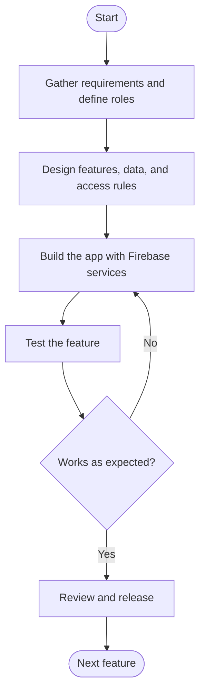
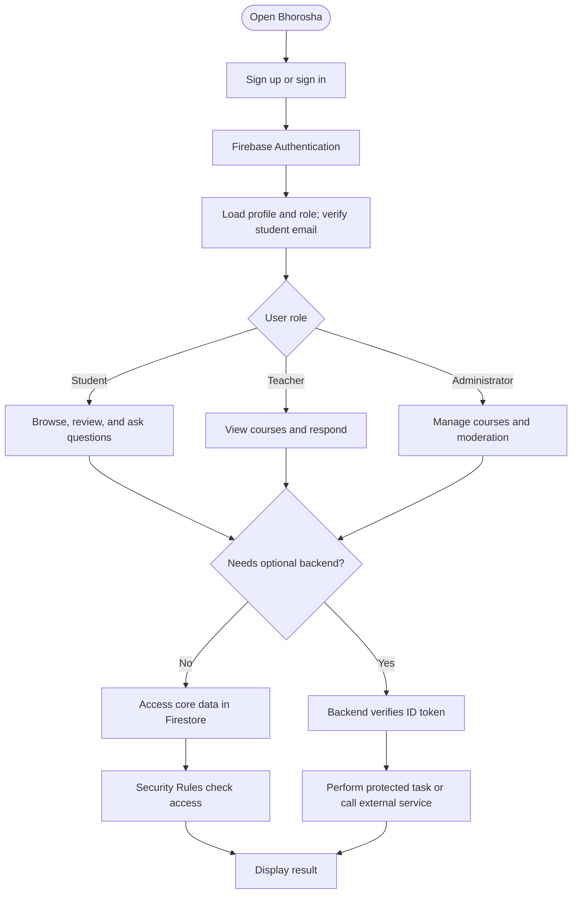

# Bhorosha

Bhorosha is a CUET-focused academic community app for discovering courses and
teachers, sharing reviews, asking questions, and connecting students with
reliable academic information.

The project contains:

- An Expo/React Native mobile and web app.
- Firebase Authentication and Firestore for accounts and academic data.
- Separate student, teacher, and administrator experiences.
- An optional Node.js/Express backend for profile-photo uploads, moderation
  warnings, and privacy-preserving AI review summaries.

## Project report: system design

The following sections describe Bhorosha's implemented architecture and core
workflows. The flowcharts are provided as Mermaid source text, not image files,
so they can be rendered or recreated as figures for a project report.

### 1. Methodology flowchart

Bhorosha follows an iterative, feature-based development process. Requirements
are translated into role-specific features and data rules, implemented in the
Expo client and Firebase services, and validated before the next iteration.



### 2. Technology stack

| Area | Technologies and role |
|---|---|
| Client application | Expo SDK 54, React Native 0.81, React 19, and TypeScript 5.9 |
| Navigation | Expo Router 6 for file-based routes and role-specific screens |
| Styling | NativeWind 4 and Tailwind CSS 3 |
| Authentication | Firebase Authentication |
| Primary data store | Cloud Firestore, protected by Firestore Security Rules |
| Optional API | Node.js 20+, Express 5, and Firebase Admin SDK |
| Optional media and AI services | Cloudinary for profile images; a configured AI-compatible provider for summaries, assistance, and moderation |
| Validation | TypeScript checks and Firestore Emulator-backed teacher-assignment regression tests |

The mobile/web client communicates directly with Firebase for core application
features. The Express service is an optional integration layer for operations
that require server-side credentials or external services; it is not required
for core browsing, reviews, questions, guides, or notifications.

### 3. Frontend layer

The frontend is a cross-platform Expo application for mobile and web. Expo
Router organizes screens by route and user role, while shared components,
feature modules, hooks, and services support reusable UI and application
logic. The main experiences are:

- **Students:** discover courses and teacher profiles; write course and teacher
  reviews; ask questions; read answers and course guides; and view activity
  and notifications.
- **Teachers:** view assigned courses and feedback, answer course questions,
  respond to reviews, and maintain profile details.
- **Administrators:** manage users, teacher profiles, courses and assignments,
  review reports and moderation activity, and view platform analytics.

The frontend uses TypeScript domain types and shared validation, formatting,
permission, and state helpers. It calls Firebase-backed services for core
features and calls the optional backend only for supported server-side
operations.

### 4. Authentication module

Firebase Authentication manages account credentials and authentication
sessions. The app supports email-and-password sign-up and sign-in, email
verification, verification-email resending, password reset, and sign-out.
Authenticated users have application profile and role information stored
separately in Firestore.

After authentication, Bhorosha uses the profile and role to provide the
appropriate student, teacher, or administrator experience. Student access to
protected features requires a verified email. Firestore Security Rules enforce
data access constraints; backend requests that require authentication send a
Firebase ID token, which the Express service verifies before performing
protected operations. Firebase credentials are not stored in application
profile documents.

### 5. Backend layer

The optional backend is a Node.js/Express service implemented in TypeScript.
It uses the Firebase Admin SDK to verify ID tokens and perform authorized
server-side operations. Implemented API capabilities include:

- Teacher profile-photo uploads to Cloudinary.
- Report submission and administrator moderation actions, including warnings.
- Optional AI review summaries, academic-assistant responses, and moderation.
- An administrative course-instance migration operation.

AI and Cloudinary credentials remain on the server. If the backend or optional
provider is not configured, backend-dependent operations are unavailable; core
client features that do not depend on them continue to use Firebase directly.

### 6. Database layer

Cloud Firestore is Bhorosha's implemented primary database; the project does
not use a relational SQL database. Firestore Security Rules govern client
access, while the optional backend uses the Firebase Admin SDK for its
authorized operations.

The stored data covers user and teacher profiles, departments, courses and
course offerings, teacher assignments, reviews and ratings, teacher responses,
questions and answers, course guides, reports and appeals, moderation history,
notifications, and activity. Private ownership records are separated from
public review and question content so a user's identity is not exposed with
anonymous contributions. Firestore documents and subcollections are organized
for the application's access patterns; the logical entities in the project's
relational-mapping documentation are not an implemented SQL schema.

### 7. System workflow

This flowchart shows the typical request path, role-specific destinations,
direct Firestore access, and the optional backend boundary.



## Features

### Students

- Students verify their email before accessing Bhorosha; teachers sign in with
  the CUET email on their admin-created profile without email verification.
  Manage a personal profile.
- Browse department courses and teacher profiles.
- Submit and edit course and teacher reviews.
- Ask course questions, read answers, and follow activity notifications.
- View review activity and aggregate feedback summaries.

### Teachers

- View assigned courses and course feedback.
- Answer student questions and respond to feedback.
- Review teaching insights and notifications.
- Maintain personal biography and profile photo details.

### Administrators

- Manage users, teacher profiles, courses, assignments, and moderation.
- View platform activity and analytics.
- Review reported content and manage account settings.

## Getting started

### Prerequisites

- Node.js 20 or newer
- npm
- Expo Go for testing on a physical device
- Java 17 only if running the Firestore emulator tests

### Install and run the app

```bash
npm install
npm run start
```

Useful Expo commands:

```bash
npm run android    # Start with a tunnel for a physical Android device
npm run ios        # Start the iOS simulator
npm run web        # Start the web build
```

The `android` script uses an Expo tunnel and does not require Android Studio,
the Android SDK, or `adb` on the development computer. Install Expo Go and scan
the QR code shown by Expo.

## Environment variables

Create a root `.env` file with the Firebase web configuration:

```dotenv
EXPO_PUBLIC_FIREBASE_API_KEY=...
EXPO_PUBLIC_FIREBASE_AUTH_DOMAIN=...
EXPO_PUBLIC_FIREBASE_PROJECT_ID=...
EXPO_PUBLIC_FIREBASE_MESSAGING_SENDER_ID=...
EXPO_PUBLIC_FIREBASE_APP_ID=...
EXPO_PUBLIC_BACKEND_URL=http://localhost:3000
```

The `EXPO_PUBLIC_*` values are bundled into the client. Do not place service
account credentials, API keys for private services, or other secrets in them.

Deploy Firestore rules and indexes before using a Firebase project:

```bash
npx firebase deploy --only firestore
```

Firebase Storage is intentionally disabled. Profile photos use the optional
backend and external image hosting instead.

## Optional backend

The mobile app works without the backend for authentication, courses, reviews,
Q&A, guides, and notifications. The backend is needed for profile-photo
uploads, identity-safe moderation warnings, and remote AI summaries.

Create `backend/.env` with:

```dotenv
FIREBASE_SERVICE_ACCOUNT_JSON={"project_id":"...","client_email":"...","private_key":"..."}
BACKEND_ALLOWED_ORIGINS=http://localhost:8081
CLOUDINARY_CLOUD_NAME=...
CLOUDINARY_API_KEY=...
CLOUDINARY_API_SECRET=...
AI_BASE_URL=https://api.openai.com/v1
AI_API_KEY=...
AI_MODEL=gpt-4o-mini
```

Keep this file private and never commit it. Start the service from the project
root:

```bash
npm install --prefix backend
npm run dev --prefix backend
```

For a production deployment:

```bash
npm run build --prefix backend
npm start --prefix backend
```

Set `EXPO_PUBLIC_BACKEND_URL` in the app `.env` to the deployed backend URL.
The backend verifies Firebase ID tokens before serving protected operations.

## Validation

Run the app type checks:

```bash
npm run typecheck
npm run check --prefix backend
```

Run the Firestore-backed teacher assignment regression tests:

```bash
npm run test:teacher-assignments
```

The regression suite uses a local Firestore emulator and does not modify
production data. It requires Java 17 and downloads the pinned Firebase CLI and
emulator on first use.

## Project structure

```text
app/        Expo Router screens and role-based navigation
components/
  common/   Shared UI primitives and states
  navigation/ Role-aware navigation chrome
  cards/    Reusable course, teacher, question, review, and advice cards
  forms/    Reusable feature forms
  feedback/ Review, report, reaction, and comment components
  layout/   Protected role layouts and auth guards
features/   Domain-owned components, hooks, services, and types
  auth/ users/ courses/ reviews/ questions/ reports/ notifications/
services/   Domain service entry points over the Firebase implementation
hooks/      Reusable auth, user, course, review, question, and notification hooks
store/      Small pure global-state helpers used by the app provider
types/      Domain type entry points grouped by feature
utils/      Validation, formatting, constants, and permission helpers
lib/        Firebase implementation, legacy service facade, types, and domain logic
providers/  Application state providers
backend/    Optional Express service
tests/      Emulator-backed regression tests
firestore.rules
            Firestore security rules
storage.rules
            Explicitly denies Firebase Storage access
```

### Refactoring and migration map

The shared architecture is being adopted incrementally to keep existing deep
links and Firebase behavior stable:

- The three role tab layouts now use `components/navigation/RoleTabsLayout`
  instead of maintaining three copies of the same tab-bar configuration.
- Existing primitives in `components/ui/ui.tsx` remain the source of truth;
  `components/common` provides stable semantic names such as `AppBar`,
  `ProfileAvatar`, `NotificationIcon`, `EmptyState`, and `FilterDropdown`.
- `components/cards`, `components/forms`, and `components/feedback` contain
  configurable feature components. Screens should use these during their next
  focused migration instead of copying markup.
- The files in `services/` are domain entry points over the existing
  `lib/services/services.ts` facade. This preserves collection names and
  enables future extraction of Firebase implementations one domain at a time.
- The `features/` tree is the preferred import surface for new feature code.
  Its service files currently wrap the compatibility facade; this is
  intentional so Firebase logic can be moved without changing collections or
  route behavior.
- `types/` provides domain-level type entry points while the legacy
  `lib/types/types.ts` remains the single compatibility source until all
  consumers are migrated.
- `components/layout/ProtectedRoute` and the role layout exports provide a
  single auth/role guard for new screens.

During migration, do not delete the legacy `app/` route aliases or the
`lib/services/services.ts` facade: existing bookmarks and imports depend on
them. Replace a screen only after its route and targeted type check have been
verified.

## Security notes

- Firestore rules enforce role- and department-aware access.
- Student accounts require verified email before protected access.
- The backend verifies Firebase ID tokens and authorizes access server-side.
- Raw review text and private service credentials are not sent to the AI
  provider by the mobile client.
- Never commit `.env` files, Firebase service-account JSON, or Cloudinary/API
  secrets.
