# Bhorosha ER diagram

This is the normalized relational ER diagram for Bhorosha's academic community
data: accounts, teacher profiles, courses and offerings, reviews, Q&A, guides,
moderation, notifications, and activity.

> **Current implementation:** Bhorosha uses Cloud Firestore. This diagram is a
> logical SQL design, not a deployed database schema. Firestore mirrors and
> query-oriented copies are intentionally not represented as separate
> authoritative entities here.

## Entity-relationship diagram

```mermaid
erDiagram
  DEPARTMENT {
    string department_id PK
    string name UK
  }
  APP_USER {
    string user_id PK "Firebase Auth UID"
    string email UK
    string name
    string role
    string department_id FK
    boolean active
    boolean email_verified
    boolean dark_mode
    int warning_count
    datetime created_at
    datetime updated_at
  }
  STUDENT_PROFILE {
    string user_id PK, FK
    string student_id UK
    string batch
    string current_level
    string current_term
  }
  TEACHER_ACCOUNT {
    string user_id PK, FK
  }
  TEACHER_PROFILE {
    string teacher_profile_id PK
    string department_id FK
    string name
    string designation
    string official_email UK "Nullable"
    string linked_user_id FK, UK "Nullable"
    string bio
    string photo_url
    boolean active
    datetime updated_at
  }
  COURSE {
    string course_id PK
    string department_id FK
    string code
    string title
    decimal credits
    string course_type
    string status
  }
  COURSE_INSTANCE {
    string course_instance_id PK
    string course_id FK
    string batch
    string level
    string term
    boolean legacy
    datetime created_at
    datetime updated_at
  }
  COURSE_TEACHER {
    string course_id PK, FK
    string teacher_profile_id PK, FK
  }
  TAG {
    string tag_id PK
    string name
    string scope
  }
  COURSE_TAG_LINK {
    string course_id PK, FK
    string tag_id PK, FK
  }
  REVIEW {
    string review_id PK
    string review_type
  }
  COURSE_REVIEW {
    string review_id PK, FK
    string course_id FK
    string course_instance_id FK "Nullable"
    string text
    boolean anonymous
    string display_name "Nullable"
    int helpful_count
    int unhelpful_count
    datetime created_at
    datetime updated_at
  }
  PROFESSOR_REVIEW {
    string review_id PK, FK
    string teacher_profile_id FK
    string text
    decimal rating
    boolean anonymous
    string display_name "Nullable"
    datetime created_at
  }
  REVIEW_OWNERSHIP {
    string review_id PK, FK
    string user_id FK
  }
  RATING_CRITERION {
    string criterion_code PK
    string label UK
  }
  COURSE_REVIEW_RATING {
    string review_id PK, FK
    string criterion_code PK, FK
    decimal score
  }
  PROFESSOR_REVIEW_ASPECT {
    string review_id PK, FK
    string aspect_code PK
    decimal score
  }
  REVIEW_TAG {
    string review_id PK, FK
    string tag_id PK, FK
  }
  TEACHER_RESPONSE {
    string response_id PK
    string review_id FK
    string teacher_profile_id FK
    string text
    datetime created_at
  }
  COURSE_QUESTION {
    string question_id PK
    string course_id FK
    string course_instance_id FK "Nullable"
    string category
    string text
    boolean anonymous
    datetime created_at
  }
  QUESTION_OWNERSHIP {
    string question_id PK, FK
    string user_id FK
  }
  QUESTION_ANSWER {
    string answer_id PK
    string question_id FK
    string author_role
    string author_name
    string text
    datetime created_at
  }
  ANSWER_OWNERSHIP {
    string answer_id PK, FK
    string user_id FK
  }
  COURSE_GUIDE {
    string guide_id PK
    string course_id FK
    string course_instance_id FK "Nullable"
    string title
    string text
    string resources "Nullable"
    datetime created_at
  }
  REPORT {
    string report_id PK
    string content_type
    string content_id "Polymorphic target"
    string course_instance_id FK "Nullable"
    string question_id FK "Nullable"
    string reporter_id FK
    string reported_user_id FK
    string reporter_role
    string reason
    string description
    string status
    string action "Nullable"
    datetime created_at
    datetime resolved_at "Nullable"
  }
  MODERATION_APPEAL {
    string appeal_id PK
    string report_id FK
    string submitted_by FK
    string reason
    string status
    datetime created_at
    datetime resolved_at "Nullable"
  }
  MODERATION_HISTORY {
    string history_id PK
    string admin_id FK "Nullable"
    string action
    string target_type
    string target_id "Polymorphic target"
    string report_id FK "Nullable"
    string summary
    datetime created_at
  }
  NOTIFICATION {
    string notification_id PK
    string recipient_user_id FK "Nullable"
    string recipient_teacher_profile_id FK "Nullable"
    string report_id FK "Nullable"
    string question_id FK "Nullable"
    string course_id FK "Nullable"
    string title
    string body
    datetime read_at "Nullable"
    datetime created_at
  }
  QUESTION_NOTIFICATION_KEY {
    string question_id PK, FK
    string notification_key PK
  }
  ACTIVITY {
    string activity_id PK
    string user_id FK
    string kind
    string target_type
    string target_id
    string course_id FK "Nullable"
    string teacher_profile_id FK "Nullable"
    string question_id FK "Nullable"
    string text
    datetime created_at
  }

  DEPARTMENT ||--o{ APP_USER : department
  DEPARTMENT ||--o{ TEACHER_PROFILE : department
  DEPARTMENT ||--o{ COURSE : department
  APP_USER ||--o| STUDENT_PROFILE : student_details
  APP_USER ||--o| TEACHER_ACCOUNT : teacher_login
  TEACHER_ACCOUNT ||--o| TEACHER_PROFILE : linked_profile
  COURSE ||--o{ COURSE_INSTANCE : offerings
  COURSE ||--o{ COURSE_TEACHER : assigned_teachers
  TEACHER_PROFILE ||--o{ COURSE_TEACHER : teaches
  COURSE ||--o{ COURSE_TAG_LINK : tagged
  TAG ||--o{ COURSE_TAG_LINK : used_on_course
  REVIEW ||--o| COURSE_REVIEW : course_review_details
  REVIEW ||--o| PROFESSOR_REVIEW : professor_review_details
  COURSE ||--o{ COURSE_REVIEW : receives
  COURSE_INSTANCE o|--o{ COURSE_REVIEW : about_offering
  TEACHER_PROFILE ||--o{ PROFESSOR_REVIEW : receives
  APP_USER ||--o{ REVIEW_OWNERSHIP : private_author
  REVIEW ||--o| REVIEW_OWNERSHIP : private_owner
  COURSE_REVIEW ||--o{ COURSE_REVIEW_RATING : has_ratings
  RATING_CRITERION ||--o{ COURSE_REVIEW_RATING : rates
  PROFESSOR_REVIEW ||--o{ PROFESSOR_REVIEW_ASPECT : has_aspects
  REVIEW ||--o{ REVIEW_TAG : has_tags
  TAG ||--o{ REVIEW_TAG : labels
  REVIEW ||--o{ TEACHER_RESPONSE : receives
  TEACHER_PROFILE ||--o{ TEACHER_RESPONSE : responds
  COURSE ||--o{ COURSE_QUESTION : has_questions
  COURSE_INSTANCE o|--o{ COURSE_QUESTION : about_offering
  COURSE_QUESTION ||--o{ QUESTION_ANSWER : has_answers
  APP_USER ||--o{ QUESTION_OWNERSHIP : private_author
  COURSE_QUESTION ||--o| QUESTION_OWNERSHIP : private_owner
  APP_USER ||--o{ ANSWER_OWNERSHIP : private_author
  QUESTION_ANSWER ||--o| ANSWER_OWNERSHIP : private_owner
  COURSE ||--o{ COURSE_GUIDE : has_guides
  COURSE_INSTANCE o|--o{ COURSE_GUIDE : about_offering
  APP_USER ||--o{ REPORT : reports
  APP_USER ||--o{ REPORT : is_reported
  COURSE_INSTANCE o|--o{ REPORT : related_offering
  COURSE_QUESTION o|--o{ REPORT : related_question
  REPORT ||--o{ MODERATION_APPEAL : appealed
  APP_USER ||--o{ MODERATION_APPEAL : submits
  APP_USER o|--o{ MODERATION_HISTORY : performs_admin_action
  REPORT o|--o{ MODERATION_HISTORY : recorded_in
  APP_USER o|--o{ NOTIFICATION : user_recipient
  TEACHER_PROFILE o|--o{ NOTIFICATION : teacher_recipient
  REPORT o|--o{ NOTIFICATION : report_notice
  COURSE_QUESTION o|--o{ NOTIFICATION : question_notice
  COURSE ||--o{ NOTIFICATION : course_notice
  COURSE_QUESTION ||--o{ QUESTION_NOTIFICATION_KEY : has_private_keys
  APP_USER ||--o{ ACTIVITY : owns
  COURSE o|--o{ ACTIVITY : course_context
  TEACHER_PROFILE o|--o{ ACTIVITY : teacher_context
  COURSE_QUESTION o|--o{ ACTIVITY : question_context
```

## Reading the diagram

- `PK` is a primary key, `FK` is a foreign key, and `UK` is a unique
  constraint. `Nullable` means the value can be absent.
- `||` means exactly one, `o|` means zero or one, and `o{` means zero or many.
- A `REVIEW` row is the shared identity for either one `COURSE_REVIEW` or one
  `PROFESSOR_REVIEW`. Exactly one subtype should exist for each review.
- `REVIEW_OWNERSHIP`, `QUESTION_OWNERSHIP`, and `ANSWER_OWNERSHIP` hold private
  author identity separately from public community content. This keeps user
  IDs, emails, student IDs, and batches out of public content records.
- `COURSE_TEACHER`, `COURSE_TAG_LINK`, `COURSE_REVIEW_RATING`, and `REVIEW_TAG`
  resolve many-to-many or multivalued data into normalized rows.
- Each notification must have exactly one recipient: either
  `recipient_user_id` or `recipient_teacher_profile_id`. Enforce that rule with
  a database `CHECK` constraint.

## Relationship and integrity notes

1. A teacher profile is the official academic identity. A linked teacher
   account is optional, allowing courses to be assigned before the teacher
   registers. Enforce uniqueness on `TEACHER_PROFILE.linked_user_id`.
2. Course assignments in this diagram belong to the course. If assignments
   differ for each semester/cohort offering, replace `COURSE_TEACHER.course_id`
   with `course_instance_id` and connect it to `COURSE_INSTANCE`.
3. Use a unique constraint on the private course-review ownership path to
   enforce at most one course review per user and course, matching the app's
   current behavior.
4. `REPORT.content_type`/`content_id`, `MODERATION_HISTORY.target_type`/
   `target_id`, and `ACTIVITY.target_type`/`target_id` are polymorphic
   references. A conventional foreign key cannot verify their target. For
   strict referential integrity, create a shared `CONTENT_ITEM` supertype with
   subtype rows, or replace each polymorphic reference with typed foreign keys
   and a constraint requiring exactly one target.
5. Firestore currently duplicates selected fields and private history mirrors
   for access control and efficient reads. Those projections are not separate
   sources of truth in this normalized relational design.

For the full table-by-table schema, Firestore collection mapping, and
normalization rationale, see [RELATIONAL_MAPPING.md](./RELATIONAL_MAPPING.md).
